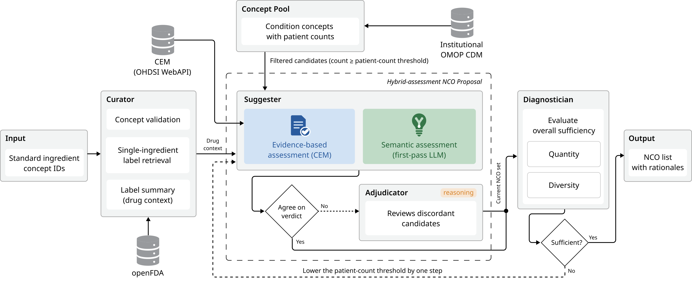

# MENTOR

This repository is the reference implementation of **MENTOR** (Multi-agent Evidence-informed Negative conTrol Outcome selection with Reasoning), a multi-agent large language model (LLM) system that selects **institution-specific negative control outcomes (NCOs)** from a database in the OMOP Common Data Model (CDM).

NCOs are used to detect systematic error and to calibrate effect estimates in observational studies, but they are still selected largely by hand. The Common Evidence Model (CEM) proposes outcomes that lack documented evidence of association with a drug, but investigators must still judge whether each candidate is a plausible null and whether it occurs often enough in their own data. MENTOR combines CEM evidence with LLM reasoning over drug labels, spends extended reasoning only on the candidates where the two disagree, and selects candidates by local patient counts.

The system supports, and does not replace, the final review by investigators. Every proposed NCO comes with the evidence and rationale behind it.



## How it works

Four agents are orchestrated as a directed graph with [LangGraph](https://github.com/langchain-ai/langgraph).

| Agent | What it does |
|---|---|
| **Curator** | Checks that each input concept ID is a standard ingredient concept, retrieves single-ingredient product labels from [openFDA](https://open.fda.gov/) (indications, mechanism of action, contraindications, boxed warnings, warnings, and adverse reactions), and has the LLM summarize them into a drug context. |
| **Suggester** | Builds the Concept Pool (every standard condition concept with its patient count, descendants included, minus a fixed exclusion list) and takes the candidates at or above the current patient-count threshold. Each candidate is assessed twice: by CEM evidence, queried through the OHDSI WebAPI, and by a first-pass LLM judgment over the drug context. Candidates on which the two agree are decided directly. Candidates not covered by CEM are excluded. |
| **Adjudicator** | Reviews only the discordant candidates, with the model's reasoning (thinking) mode, given the CEM evidence and the first-pass rationale. |
| **Diagnostician** | Judges whether the current NCO set is large and diverse enough, counting parent–child or near-synonymous concepts as one. If it is not, the patient-count threshold is lowered by one step and the Suggester and Adjudicator process the newly eligible candidates. The search stops when the target is reached or the next threshold would fall below the floor. |

An outcome is a valid NCO only if, for every input ingredient, it is not an indication, not a contraindication or known adverse effect, and has no causal pathway through the drug's mechanism, metabolism, or pharmacokinetics.

## Requirements

- Python 3.10 or later
- An OMOP CDM database on **Microsoft SQL Server** (the code connects with `pymssql`)
- An LLM served by **[vLLM](https://github.com/vllm-project/vllm)** through its OpenAI-compatible API. Reasoning mode is switched with `chat_template_kwargs.enable_thinking`, so the model must support it (e.g. the Qwen3 family). The experiments in the paper used Qwen3.6-27B (FP8).
- Internet access to openFDA and to an OHDSI WebAPI with CEM (the public ATLAS demo instance by default)

```bash
pip install -r requirements.txt
```

## Configuration

### 1. Database (`.env`)

Copy `.env.example` to `.env` and fill in your CDM connection and table names.

```bash
cp .env.example .env
```

| Variable | Meaning |
|---|---|
| `DATABASE_HOST`, `DATABASE_DATABASE`, `DATABASE_USER`, `DATABASE_PASSWORD` | SQL Server connection |
| `CONCEPT_TABLE`, `CONCEPT_ANCESTOR_TABLE`, `CONDITION_OCCURRENCE_TABLE` | fully qualified CDM tables, e.g. `[CDM].[dbo].[concept]` |
| `OPENFDA_API_KEY` | optional; without a key, openFDA allows 1,000 requests per day |

### 2. LLM and run parameters (`src/core/config/experiment.py`)

Set your vLLM endpoint and model in `MODELS`. The same file holds the defaults for every run parameter.

| Key | Meaning |
|---|---|
| `search.min_patients` / `min_floor` / `step` | first patient-count threshold, lowest threshold, and decrease per iteration |
| `<role>.thinking` | reasoning mode per agent (`None` uses the model preset); the main configuration enables it for the Adjudicator only |
| `curator.mode` | `summary` (LLM-summarized labels), `raw` (labels as fetched), or `name_only` (no labels) |
| `suggestor.use_hierarchy` | give ancestor concepts (up to `hierarchy_parent_levels` levels) to the first pass and the Adjudicator |
| `diagnostician.target_nco_count` | target number of effective (de-duplicated) NCOs; default 100 |
| `openfda.single_ingredient` | use single-ingredient labels only (combination products excluded) |
| `cem.base_url` | OHDSI WebAPI used for CEM queries |

Values can also be changed per run with `overrides` (see below) without editing the file. Unknown keys raise an error before anything runs.

## Usage

Open **`run.ipynb`**, set the ingredient concept IDs, and run the cells. The notebook ends with the final NCO list.

Or call it from Python:

```python
from main import run_experiment

result = run_experiment(
    ingredient_concept_ids=[45774751, 1580747],      # empagliflozin vs sitagliptin
    name="empagliflozin_sitagliptin",
    overrides={"search": {"min_patients": 10000, "min_floor": 10000, "step": 10000}},
)
print(result["status"], result["nco_count"], result["run_dir"])
```

`ingredient_concept_ids` are OMOP standard ingredient concept IDs (RxNorm). A drug class is given as its ingredients. Each ingredient adds its own drug context and CEM query, so more ingredients mean stricter NCOs and a longer run. The drug pairs in the paper were:

| Pair | Concept IDs |
|---|---|
| empagliflozin vs sitagliptin | `45774751`, `1580747` |
| warfarin vs apixaban | `1310149`, `43013024` |
| lisinopril vs hydrochlorothiazide | `1308216`, `974166` |

### Outputs

Each run writes to its own folder, `logs/<time>_<name>/`.

| File | Contents |
|---|---|
| `nco_list.csv` | final NCOs with patient count, CEM check, whether CEM and the LLM agreed or the Adjudicator decided, and the rationale |
| `concept_set.json` | the NCOs as an ATLAS concept set expression (Concept Sets > Import, or the negative control concept set of an Estimation design), descendants included |
| `negative_control_outcomes.csv` | the NCOs as a CohortGenerator/Strategus `negativeControlOutcomeCohortSet` (`cohortId`, `cohortName`, `outcomeConceptId`); generate the cohorts with `detectOnDescendants = TRUE` |
| `final_state.json` | full agent state, including every reviewed candidate |
| `cem_result.csv` | raw CEM evidence for the ingredients |
| `run.log` | progress log with timing and token usage per step |

## Data

- `data/excluded_concepts_broad_preg.csv` is the fixed exclusion list shared across institutions: 15,951 concepts that are unsuitable as NCOs regardless of the drug pair (overly broad or nonspecific concepts, and pregnancy-related concepts).
- `data/person_count_with_descendants.csv` is the Concept Pool. It is built from your CDM on the first run and reused afterwards. Delete it after your CDM is refreshed so it is rebuilt. It contains institutional counts and is excluded from version control.

## Data privacy

Patient-level data stay inside the institution. The self-hosted LLM receives concept names, drug information, and aggregate patient counts. openFDA receives ingredient names, and the CEM WebAPI receives ingredient concept IDs. No patient data are sent to external services.

## Citation

If you use this code, please cite:

> T. Yang et al., MENTOR: An Evidence-Informed Large Language Model-Based Multi-Agent System for Efficient Selection of Institution-Specific Negative Control Outcomes, medRxiv (2026). doi: [to be added]

## License

Released under the [MIT License](LICENSE).

## Contact

- **Taeseok Yang**, Department of Biomedical Sciences, Graduate School of Ajou University, Suwon, Republic of Korea · tsyang0123@ajou.ac.kr
- **Chungsoo Kim** (corresponding author), Department of Biomedical Informatics, Ajou University School of Medicine, Suwon, Republic of Korea · ted9219@ajou.ac.kr
